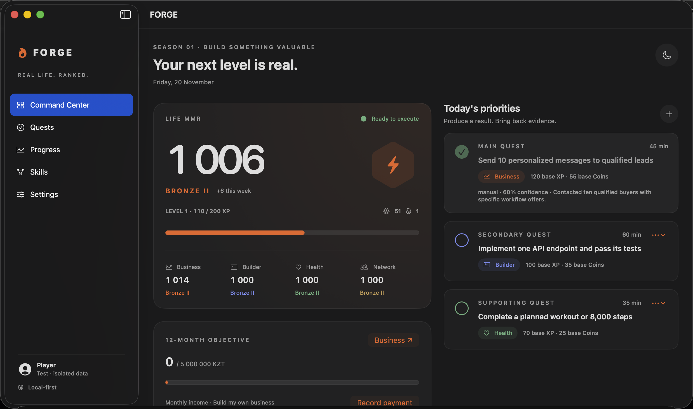
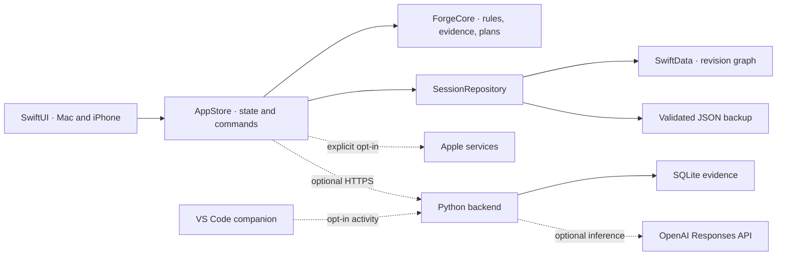

# FORGE

FORGE is an offline-first productivity app for Mac and iPhone. It turns daily priorities into quests, asks you to record what actually changed, and awards experience, rating and Coins according to explicit game rules. Your workspace lives on the device. The core app needs no server, account or API key.



## What you can do

- Set an objective and work through daily priorities. Complete a quest with a result and review the rewards in Progress.
- Track received payments and pipeline activity, record practical skill evidence, and review or recover a difficult day.
- Compare current activity with past performance through the ledger, streaks, bosses and Ghost.
- Get a plan from the local Game Master and decide whether to apply it.
- Export and restore a backup. Review divergent revisions when automatic merging would risk changing progression.

## Why the implementation matters

The Swift core calculates progression independently of SwiftUI, network services and Apple permissions. A quest completion produces a candidate session and ledger entries. The app validates and commits that candidate before displaying the rewards. An imported reference becomes evidence only when attached to an explicit completion.

SwiftData stores immutable revision envelopes with parent IDs. Before writing, the repository confirms that the known heads still match the stored heads. The automatic merge allows independent additions to selected lists when protected state agrees. Other branches stay available for review. See [engineering decisions](docs/ENGINEERING_DECISIONS.md) for the failure modes and storage tradeoffs.

## Architecture



FORGE uses Swift 6, SwiftUI, SwiftData, Foundation, Apple platform frameworks and XCTest. The companion uses JavaScript and VS Code APIs. The Python backend uses the standard library and SQLite. The Swift package, backend and companion declare no third-party runtime packages.

## Getting started

Use a Mac with **Xcode 27.2** and its Swift toolchain. Install an iPhone Simulator runtime through Xcode if needed. The full terminal gate also uses **Python 3.10+** and **Node 20+**.

1. Clone this repository and open `FORGE.xcodeproj`. The shared project and scheme are checked in.
2. Select the **FORGE** scheme. Choose **My Mac** or an installed **iPhone simulator**, then choose **Product → Run**.
3. Complete onboarding. Open **Quests**, record a result for the main quest, and see its receipt in **Progress → Transaction History**.
4. Quit and reopen. Your quest and rewards should still be present. In Settings, use backup export before trying restore with an isolated workspace.

For a terminal-based Mac launch, use `swift run ForgeDesktop`. The Xcode app is the recommended entry point for native file export and permission-backed features. If project inputs change, regenerate with `python3 scripts/generate_project.py` and run its `--check` mode before committing.

The [backend setup](server/README.md) and [VS Code companion setup](Integrations/VSCode/README.md) are separate. Use [account setup](docs/ACCOUNT_SETUP.md) for personal signed builds and optional Apple capabilities.

## Source layout

| Path | Responsibility |
| --- | --- |
| `App/` | SwiftUI screens, app coordination, SwiftData persistence and Apple adapters |
| `Sources/ForgeCore/` | Game rules, session changes, validation, planning and evidence |
| `Tests/` and `UITests/` | Swift core tests and native UI acceptance |
| `Sources/ForgeIntegrationCheck/` | Real Swift client check against an isolated backend |
| `server/` and `Integrations/VSCode/` | Optional backend and editor companion |
| `Config/` and `scripts/` | Signing configuration, project generation and verification |
| `docs/` | Architecture decisions, release evidence and interview guide |

## Verification

```sh
bash scripts/verify_release.sh
bash scripts/verify_mac_ui.sh
xcrun simctl list devices available
FORGE_UI_SIMULATOR_UDID="<installed iPhone simulator ID>" bash scripts/verify_release.sh
```

The terminal gate checks project consistency, runs Swift, Python and Node suites, performs disk and loopback HTTP smoke tests, and builds Mac and iOS Simulator targets. The isolated Mac UI script signs its generated runner for local development and checks the real app. The simulator option runs the native UI suite on the selected device. See [release notes](RELEASE_NOTES.md) for observed results and [the CI workflow](.github/workflows/verify.yml) for hosted coverage.

## Screenshots and demo

The linked walkthrough uses synthetic fixtures from native XCTest. It shows the Command Center before completion, after recording proof, and after a full app relaunch. [Open the native walkthrough](docs/demo/README.md).

## Compatibility and limits

- The V1 UI verification matrix covers Apple silicon Mac and iPhone Simulator. macOS 14 and iOS 17 are the declared deployment targets. Runtime verification on those minimum versions, Intel Mac, iPad, and VoiceOver is outside the recorded matrix.
- HealthKit, CloudKit, Calendar, notifications, Keychain and Screen Time require the relevant Apple environment or permissions. A compiled adapter does not establish authorization or delivery. The Mac focus timer has no system app shielding.
- The local Game Master works offline. Live OpenAI, GitHub and n8n are optional. Provider/configuration examples and the deterministic fixture do not represent a deployed service.
- Manual evidence is self-reported. Backups contain user records and are intended for private storage. A backup checksum helps detect accidental damage and does not authenticate its author.
- The repository contains source and verification instructions. It does not include a notarized Mac installer or an App Store release.

The next engineering work is wider accessibility and signed-device verification, longer persistence measurements, and finer diagnostics for optional services. See [roadmap](ROADMAP.md), [security notes](docs/SECURITY.md), [release notes](RELEASE_NOTES.md), and [interview guide](INTERVIEW_GUIDE.md).
